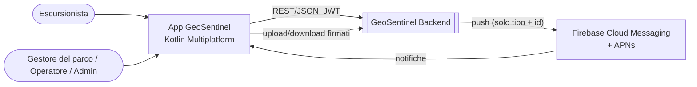
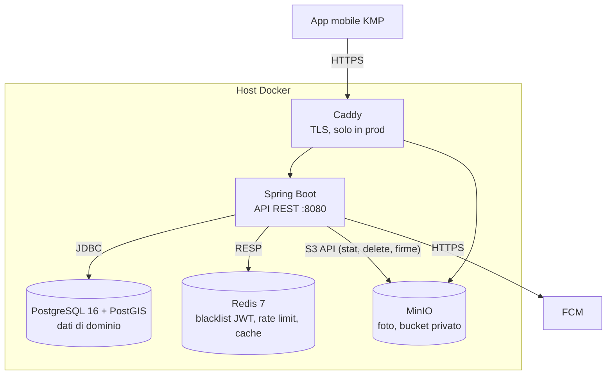
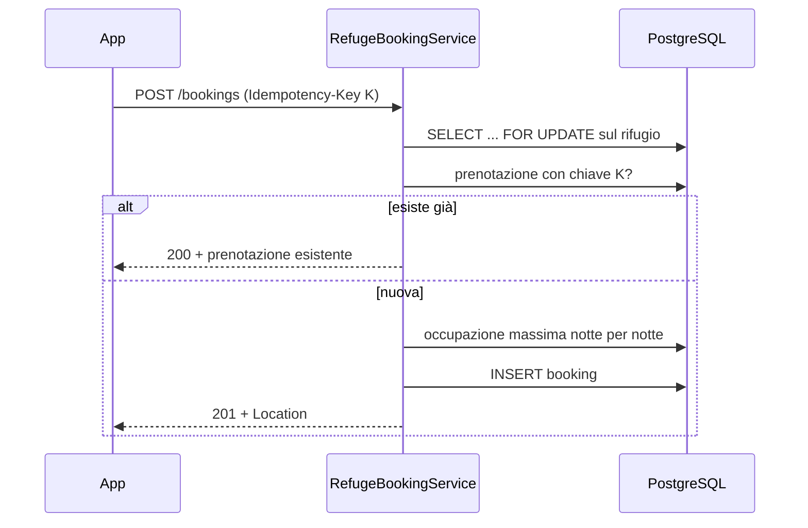
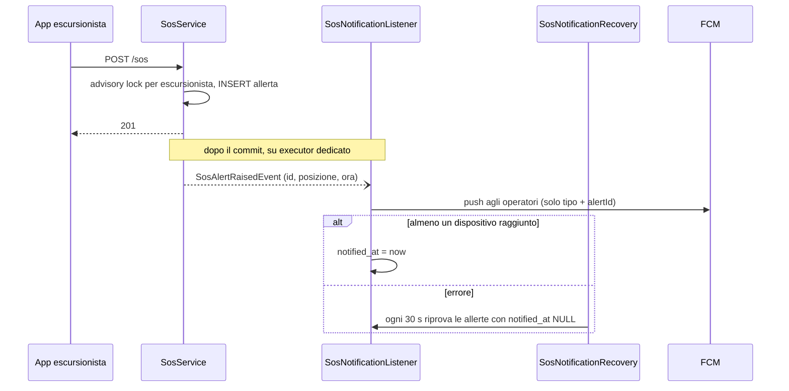

# Architettura di GeoSentinel Backend

Segue lo schema [arc42](https://arc42.org), in versione ridotta, con i diagrammi [C4](https://c4model.com)
in Mermaid. Il perché delle scelte sta negli [ADR](adr/README.md). Il contratto dell'API è
[`openapi.json`](openapi.json) e la [guida all'API](api-guide.md) lo spiega.

## 1. Introduzione e obiettivi

GeoSentinel è una piattaforma per la sicurezza dei sentieri di montagna. Il backend serve un solo client,
un'app mobile Kotlin Multiplatform (Android e iOS).

| Funzione | Cosa fa |
|---|---|
| Catalogo | Sentieri (percorso GeoJSON, stato, difficoltà) e punti di interesse, ricerca per raggio e per area |
| Segnalazioni | Gli escursionisti segnalano pericoli; i gestori del parco le verificano |
| Rifugi | Disponibilità notte per notte e prenotazioni senza overbooking |
| Manutenzione | Ticket su sentieri, rifugi o segnalazioni, con assegnazione e stati |
| Emergenze | SOS con posizione in tempo reale, invio di una squadra di soccorso, notifiche push agli operatori |
| Media | Foto caricate direttamente sullo storage, verificate e allegate a sentieri o segnalazioni |
| Account | Registrazione con età minima, profilo, cambio password, cancellazione con anonimizzazione |

### Obiettivi di qualità

| Priorità | Qualità | Scenario |
|---|---|---|
| 1 | Affidabilità | Un SOS non va mai perso né duplicato, anche con rete instabile e retry del client |
| 2 | Correttezza sotto concorrenza | 50 prenotazioni simultanee su 10 posti: esattamente 10 accettate |
| 3 | Sicurezza | Nessun accesso ai dati altrui, sessioni revocabili su tutti i dispositivi, dati personali minimizzati |
| 4 | Efficienza su rete mobile | Risposte compresse, GET condizionali, contratto di retry esplicito |
| 5 | Manutenibilità | Package per feature, regole di dipendenza esplicite, test di integrazione su infrastruttura reale |

### Stakeholder

| Ruolo | Interesse |
|---|---|
| Escursionista (`HIKER`) | Consultare sentieri, prenotare, segnalare, chiedere soccorso |
| Gestore del parco (`PARK_MANAGER`) | Mantenere catalogo, rifugi e ticket |
| Operatore di soccorso (`RESCUE_OPERATOR`) | Ricevere e gestire gli SOS, inviare squadre |
| Amministratore (`ADMIN`) | Squadre di soccorso, moderazione, account del personale |
| Sviluppatore dell'app | Un contratto API stabile da cui generare il client |

## 2. Vincoli

- Java 21, Spring Boot 4.1 (Spring Framework 7, Security 7, Hibernate 7, Jackson 3): [ADR-0001](adr/0001-spring-boot-4.md).
- PostgreSQL 16 + PostGIS, coordinate WGS 84 (SRID 4326).
- Nessun frontend web: niente CORS né cookie ([ADR-0013](adr/0013-client-unico-kmp.md)).
- GDPR: età minima per registrarsi (14 anni in Italia), minimizzazione, diritto alla cancellazione.
- App Store e Google Play: la cancellazione dell'account deve essere possibile dall'app.
- Progetto universitario: in esercizio sul PC dello sviluppatore; lo stack di produzione esiste ma non è in uso.

## 3. Contesto (C4 livello 1)

L'app parla con il backend in REST/JSON. Le foto viaggiano direttamente tra l'app e l'object storage con
URL firmati dal backend. Le notifiche push passano da FCM, che le inoltra ad APNs per iOS.

## 4. Strategia della soluzione

| Problema | Soluzione | Dettagli |
|---|---|---|
| Struttura del codice | Esagonale pragmatico, package per feature | [ADR-0002](adr/0002-esagonale-pragmatico.md) |
| Autenticazione | JWT HS256 con resource server di Spring, refresh token opaco ruotato | [ADR-0003](adr/0003-jwt-resource-server.md), [ADR-0004](adr/0004-refresh-token-opaco.md) |
| Overbooking e doppio soccorso | Lock pessimistico sulla riga del rifugio / dell'allerta | [ADR-0014](adr/0014-lock-pessimistico.md) |
| Retry della rete mobile | `Idempotency-Key` con vincolo `UNIQUE` nel database | [ADR-0012](adr/0012-idempotency-key.md) |
| Query spaziali in metri | `geography` + indice GiST sull'espressione | [ADR-0006](adr/0006-geography-gist.md) |
| Foto pesanti | Upload diretto sullo storage con presigned POST policy | [ADR-0015](adr/0015-presigned-post-policy.md) |
| Notifiche affidabili | Evento dopo il commit + recupero con `notified_at` | [ADR-0016](adr/0016-push-fcm-diretto.md) |
| Errori uniformi | RFC 7807 `ProblemDetail` con slug stabili | [guida all'API](api-guide.md#errori) |

## 5. Vista a blocchi (C4 livello 2: container)

In sviluppo Caddy non c'è: l'app raggiunge direttamente il backend sulla 8080 e MinIO sulla 9000.

### Componenti del backend (C4 livello 3)

Ogni feature è un package con quattro strati: `domain` (entità JPA e regole), `application` (service
transazionali, porte), `infrastructure` (repository, adattatori Redis/MinIO/FCM), `web` (controller, DTO,
mapper).

| Feature | Responsabilità | Dipende da |
|---|---|---|
| `shared` | Entità auditabile, eccezioni, configurazioni, gestione errori, DTO geografici | nessuna |
| `identity` | Utenti, ruoli, JWT, refresh token, rate limit, profilo, cancellazione account | `refuge`, `emergency`, `media`, `notification` (pulizia alla cancellazione) |
| `trail` | Sentieri, POI, segnalazioni di pericolo | nessuna |
| `refuge` | Rifugi, disponibilità, prenotazioni | nessuna |
| `maintenance` | Ticket di manutenzione | `trail`, `refuge`, `identity` |
| `emergency` | SOS, squadre, notifiche, conservazione dei dati | `identity`, `notification` |
| `media` | Metadati delle foto, storage, verifica del contenuto | `trail` |
| `notification` | Token dei dispositivi, invio push | nessuna |

Regole di dipendenza: `domain` non conosce gli altri strati; `web` non usa i repository; una feature usa i
service di un'altra, mai i suoi repository. Le porte esistono solo per i sistemi esterni sostituibili
(`ObjectStorage`, `TokenBlacklist`, `LoginAttemptLimiter`, `PushNotifier`).

### Modello dei dati

Dodici tabelle, tutte con chiave UUID e colonne di audit (`created_at/by`, `updated_at/by`). Schema gestito
da Flyway (da `V1` a `V9`, ormai immutabili); Hibernate lo valida soltanto (`ddl-auto=validate`).

| Tabella | Contenuto | Note |
|---|---|---|
| `users`, `refresh_tokens` | Account e sessioni | refresh token salvati come hash SHA-256; `deleted_at` per gli account anonimizzati |
| `trails`, `pois` | Catalogo | `path geometry(LineString, 4326)`, `length_m` colonna generata, indici GiST su `::geography` |
| `refuges`, `bookings` | Rifugi e prenotazioni | `UNIQUE (user_id, idempotency_key)` |
| `hazard_reports` | Segnalazioni | `reporter_id`, mai esposto dall'API |
| `maintenance_tickets` | Ticket | `version` per il lock ottimistico |
| `sos_alerts`, `rescue_teams` | Emergenze | al massimo un'allerta attiva per escursionista (indice unico); `notified_at`, `anonymized_at` |
| `media_files` | Metadati delle foto | l'oggetto sta in MinIO con chiave generata dal server |
| `device_tokens` | Token FCM | `UNIQUE (token)` |

## 6. Vista a runtime

### Prenotazione con retry

La chiave si cerca dopo il lock: due retry simultanei si mettono in fila e il secondo trova la riga del primo.

### SOS e notifica agli operatori

### Upload di una foto

1. L'app chiede una policy (`POST /media/upload-requests`): il backend valida tipo, dimensione, quota e
   destinazione, salva la riga `PENDING_UPLOAD` e firma una POST policy.
2. L'app carica il file direttamente su MinIO; MinIO rifiuta file più grandi o con un tipo diverso.
3. L'app chiama `confirm`: il backend legge dimensione e primi byte; se non sono l'immagine dichiarata,
   l'oggetto viene cancellato e il media va in `QUARANTINED`.
4. Un job cancella ogni 15 minuti gli upload mai confermati.

## 7. Vista di deployment

| Ambiente | Come | Note |
|---|---|---|
| Sviluppo | `docker compose up -d` (PostGIS, Redis, MinIO) + app dall'IDE con profilo `local` | seed di prova, Swagger acceso |
| Test | Testcontainers (PostGIS, Redis, MinIO solo per `MediaUploadIT`) | profilo `test`, job programmati spenti |
| CI | GitHub Actions: `verify`, `docker`, `secrets` (gitleaks) | Dependabot su Maven, Docker, Actions |
| Produzione (pronta, non in uso) | `docker-compose.prod.yml`: Caddy (TLS) davanti a backend e MinIO, backup giornalieri | profilo `prod`, solo porte 80/443 esposte |

Dettagli operativi nel [runbook](operations.md).

## 8. Concetti trasversali

Ogni errore è `application/problem+json` (RFC 7807) con un `type` stabile, il `traceId` e, se è un errore
di validazione, `errors[]`. Lo stesso formato esce da `GlobalExceptionHandler` e dai filtri di sicurezza.
La sicurezza ha un documento a parte: [SECURITY.md](../SECURITY.md).

Per la concorrenza ci sono tre meccanismi. Rifugi e SOS usano il lock pessimistico con `lock_timeout = 3s`,
i ticket il lock ottimistico con `If-Match`, mentre l'unicità dell'SOS attivo per escursionista e la quota
dei media passano da un advisory lock. Quando servono due lock, l'ordine è sempre allerta → squadra.

Il tempo arriva da un `Clock` iniettato, e istanti e `timestamptz` sono in UTC. `LocalDate` si usa solo per
le notti di prenotazione.

La cache è su Redis e contiene solo DTO, con un serializer JSON tipizzato per ogni cache e `transactionAware`.
Se una cache non è registrata l'avvio fallisce, invece di ripiegare in silenzio sulla serializzazione Java.

Per l'osservabilità c'è Micrometer Tracing (OpenTelemetry): il `traceId` finisce nei log e nelle risposte
d'errore. `/actuator/health` è pubblico ma non dà dettagli.

Nei log e nelle push non compaiono posizioni, note mediche o nomi. Dopo 90 giorni le posizioni degli SOS
vengono arrotondate, e gli account cancellati restano solo in forma anonima.

I lavori programmati sono quattro:

| Job | Quando | Cosa |
|---|---|---|
| `SosNotificationRecovery` | ogni 30 s | rinvia le notifiche SOS non consegnate |
| `MediaCleanupJob` | ogni 15 min | cancella righe e oggetti degli upload mai confermati |
| `RefreshTokenCleanupJob` | 03:30 UTC | cancella le famiglie di refresh token scadute |
| `SosDataRetentionJob` | 04:00 UTC | anonimizza gli SOS chiusi da più di 90 giorni |

## 9. Decisioni architetturali

Elenco completo in [`adr/README.md`](adr/README.md).

## 10. Requisiti di qualità verificati

| Scenario | Verifica |
|---|---|
| Nessun overbooking | `RefugeBookingConcurrencyIT`: 50 richieste su 10 posti → 10 × 201, 40 × 409, ripetuto 5 volte |
| Una sola squadra per SOS | `SosAssignmentConcurrencyIT`: 10 dispatch → 1 × 200, 9 × 409 |
| Retry senza duplicati | `IdempotencyIT`: 10 retry con la stessa chiave → una riga |
| Lock ottimistico | `MaintenanceOptimisticLockIT`: `If-Match` concorrenti → 200 + 409 |
| Contratto API stabile | `OpenApiContractIT`: snapshot di `openapi.json` |
| Errori uniformi | `ProblemDetailContractIT` |
| Notifiche affidabili | `SosNotificationRecoveryIT`, `SosPushIT` |
| Upload sicuro | `MediaUploadIT` con MinIO reale |
| Coordinate lon/lat | `TrailSpatialQueryIT` (test di regressione) |

## 11. Rischi e debito tecnico

| Rischio | Impatto | Mitigazione |
|---|---|---|
| Un rifugio molto richiesto serializza tutte le sue prenotazioni (lock sulla riga) | Latenza in picchi | Accettato: volumi bassi |
| Notifiche SOS duplicate (crash tra invio e `notified_at`) | Doppia notifica | L'app tollera i duplicati |
| MinIO da un fork della community (`pgsty`) | Aggiornamenti incerti | Versione bloccata, Dependabot |
| Nessun tetto ai token push per utente | Crescita della tabella | Rate limit generale |
| Backup sullo stesso server | Persi con il server | Copia esterna quando i dati saranno reali |

## 12. Glossario

| Termine | Significato |
|---|---|
| Allerta / SOS | Richiesta di soccorso di un escursionista, con posizione aggiornabile |
| Dispatch | Invio di una squadra di soccorso su un'allerta |
| Famiglia di refresh token | Catena di refresh token nata da un login; il riuso di un token vecchio revoca l'intera famiglia |
| Idempotency-Key | UUID generato dal client per un'azione; i retry con la stessa chiave non creano duplicati |
| POST policy | Documento firmato che permette al client un solo upload, con tipo e dimensione vincolati |
| Quarantena | Stato di una foto il cui contenuto non corrisponde al tipo dichiarato |
| Slug | Parte finale del `type` di un errore RFC 7807, stabile e usata dal client |
